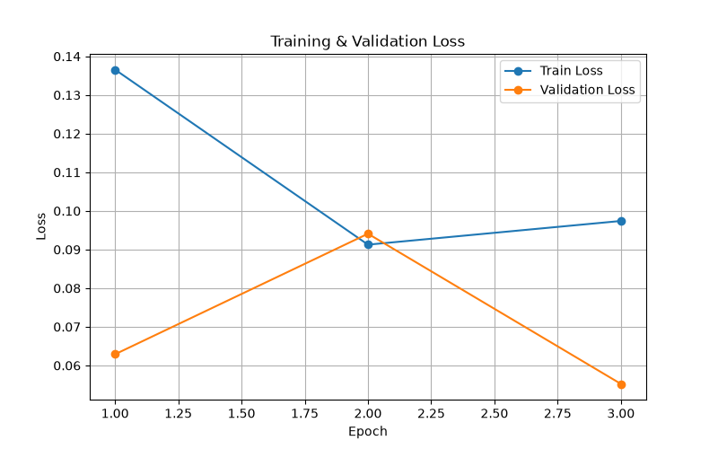
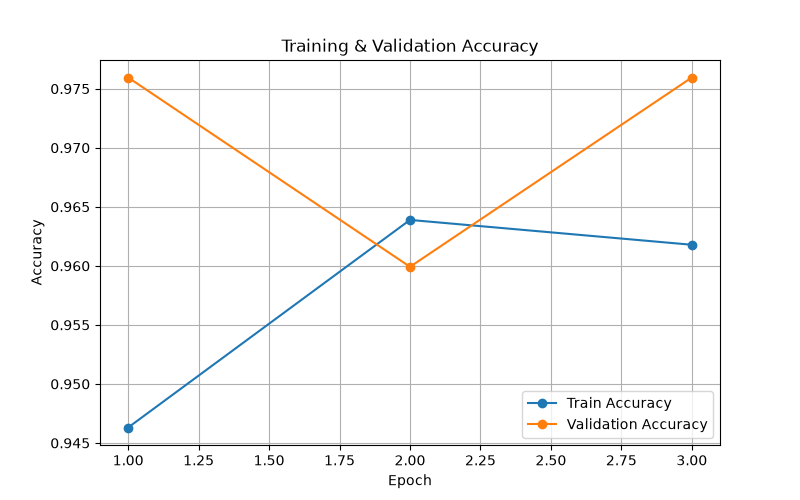
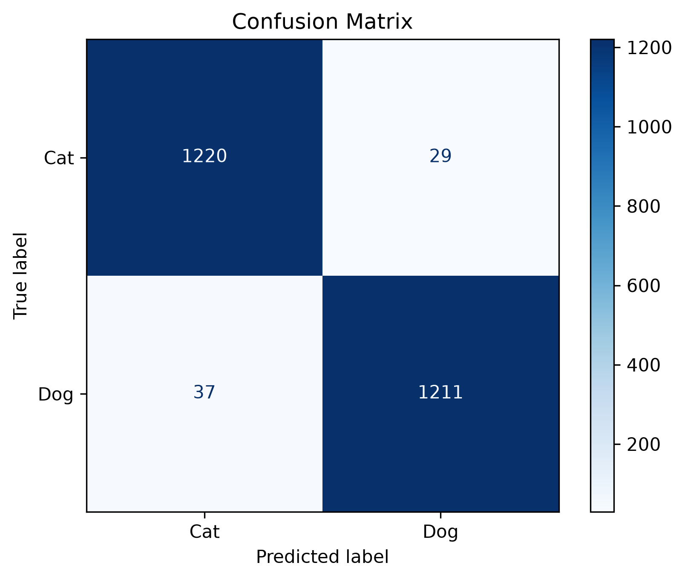

# 🐱🐶 Professional Image Classification using PyTorch

A complete end-to-end deep learning image classification project built with **PyTorch** using **Transfer Learning (ResNet18)**.

This project demonstrates a professional image classification pipeline including data loading, training, validation, evaluation, prediction, visualization, and checkpoint management.

---

# 🚀 Features

- Transfer Learning using ResNet18
- PyTorch Dataset & DataLoader
- Image Augmentation
- Training & Validation Pipeline
- Model Checkpoint Saving
- Early Stopping
- Accuracy & Loss Tracking
- Confusion Matrix
- Classification Report
- Single Image Prediction
- Training Visualization
- Modular Project Structure

---

# 📂 Project Structure

```text
Professional_Image_Classification/

├── checkpoints/
│   └── best_model.pth
│
├── data/
│   ├── train/
│   ├── val/
│   └── test/
│
├── outputs/
│   ├── loss_curve.png
│   ├── accuracy_curve.png
│   ├── confusion_matrix.png
│   └── prediction.png
│
├── src/
│   ├── config.py
│   ├── dataset.py
│   ├── engine.py
│   ├── model.py
│   └── utils.py
│
├── train.py
├── evaluate.py
├── predict.py
├── plot_curves.py
├── confusion_matrix.py
├── requirements.txt
└── README.md
```

---

# 📊 Dataset

Dataset: **Microsoft Cats vs Dogs**

Classes:

- Cat
- Dog

The dataset is divided into:

- Training Set
- Validation Set
- Test Set

---

# 🧠 Model

Pretrained Model:

**ResNet18**

Transfer Learning Strategy:

- Frozen Backbone
- Custom Classification Head
- CrossEntropyLoss
- Adam Optimizer

---

# ⚙️ Training Configuration

| Parameter | Value |
|-----------|-------|
| Epochs | 3 |
| Batch Size | 32 |
| Image Size | 224 × 224 |
| Optimizer | Adam |
| Learning Rate | 0.001 |
| Weight Decay | 1e-4 |

---

# 📈 Results

| Metric | Score |
|---------|-------|
| Test Accuracy | **97.68%** |

---

# 📉 Training Curves

Training and validation curves are automatically generated after training.

Loss Curve



Accuracy Curve



---

# 📊 Confusion Matrix

Model evaluation using a confusion matrix.



---

# 🔍 Prediction

Predict a single image.

```bash
python predict.py
```

Example Output

```
Prediction : Dog
Confidence : 99.82%
```

---

# 🏋️ Training

```bash
python train.py
```

---

# 📈 Evaluation

```bash
python evaluate.py
```

---

# 📊 Generate Curves

```bash
python plot_curves.py
```

---

# 📊 Generate Confusion Matrix

```bash
python confusion_matrix.py
```

---

# 📦 Installation

Clone the repository

```bash
git clone <repository-url>
```

Install dependencies

```bash
pip install -r requirements.txt
```

Run Training

```bash
python train.py
```

---

# 🚀 Future Improvements

- Fine-tune the entire ResNet18 network
- Mixed Precision Training (AMP)
- Learning Rate Scheduler
- TensorBoard Integration
- Grad-CAM Visualization
- Streamlit Web Application
- Docker Support

---

# 👨‍💻 Author

**Ajmal**

Aspiring AI Engineer

Focused on:

- Machine Learning
- Deep Learning
- Computer Vision
- PyTorch
- AI Applications

---